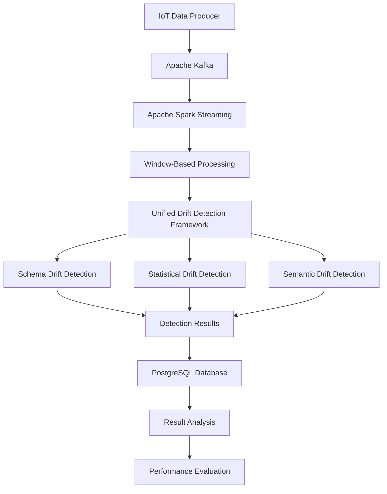

# A Unified Framework for Schema, Statistical, and Semantic Drift Detection in Streaming ETL Pipelines

<p align="center">
  <strong>Detecting data quality degradation and distribution changes in real-time streaming ETL systems</strong>
</p>

<p align="center">
  
  
  
  
  
</p>

---

## 1. Project Overview

Modern data engineering systems rely on streaming ETL (Extract, Transform, Load) pipelines to continuously collect, process, transform, and store data from multiple sources. These pipelines are commonly used in IoT applications, financial systems, monitoring platforms, recommendation systems, and real-time analytics.

However, streaming data is not always consistent. Data structures may change, statistical distributions may shift, and values may become inconsistent with their intended meaning.

These changes can introduce data quality problems and negatively affect downstream analytics, machine learning models, and business decisions.

Traditional monitoring approaches generally focus on individual aspects of data quality. Schema validation identifies structural changes, statistical drift detectors identify distribution changes, and metadata validation checks whether values follow predefined rules. When these approaches operate independently, they may fail to provide a complete picture of data degradation.

This project develops a **unified drift detection framework** that combines three complementary detection dimensions:

1. **Schema Drift Detection** – Identifies structural changes in incoming data.
2. **Statistical Drift Detection** – Identifies changes in numerical and categorical data distributions.
3. **Semantic Drift Detection** – Identifies violations of metadata contracts, expected units, valid ranges, and domain definitions.

The framework integrates these detection mechanisms into a streaming ETL architecture using Apache Kafka, Apache Spark, Python-based detection logic, and PostgreSQL.

The objective is to evaluate whether combining structural, statistical, and semantic validation provides more comprehensive drift detection than relying on individual detection mechanisms.

---

## 2. Problem Statement

Streaming ETL pipelines continuously process data generated by dynamic sources. Over time, the characteristics of incoming data may change without any explicit notification.

Examples include:

- A new column being introduced into an incoming dataset.
- An existing column being removed or renamed.
- A numerical measurement suddenly exhibiting a different mean or variance.
- A categorical attribute containing previously unseen values.
- A sensor reporting measurements in an unexpected unit.
- A field containing values outside its expected operational range.
- A data source changing the meaning or interpretation of an existing attribute.

These changes can propagate through the ETL pipeline and affect downstream systems.

A schema validator alone cannot identify every statistical change. Similarly, a statistical detector may identify a distribution shift without understanding whether the underlying values violate the intended data contract.

Therefore, a comprehensive monitoring approach needs to consider the structure, statistical characteristics, and semantic meaning of incoming data together.

**Research Problem:** How effectively can schema, statistical, and semantic drift detection mechanisms be integrated into a unified framework for identifying data quality changes in streaming ETL pipelines?

---

## 3. Project Objectives

The major objectives of this project are:

- Design a streaming ETL architecture capable of processing continuous data.
- Implement schema drift detection for structural inconsistencies.
- Implement statistical drift detection for numerical and categorical distribution changes.
- Introduce semantic validation using metadata and data contracts.
- Integrate the three detection dimensions into a unified detection framework.
- Evaluate the individual and combined contributions of the detection mechanisms.
- Compare the unified approach against established streaming drift detection algorithms.
- Measure detection performance using precision, recall, F1-score, and false positive rate.
- Examine detection behavior under different controlled drift scenarios.
- Analyze the practical limitations of unified drift detection in streaming environments.

---

## 4. System Architecture

The system follows a streaming data processing architecture in which incoming telemetry data passes through ingestion, processing, detection, and storage stages.

### High-Level Architecture



### Architecture Components

#### 4.1 Data Producer

The producer generates IoT telemetry records that simulate continuously arriving sensor data.

The generated records provide the input for the streaming pipeline and allow the framework to evaluate different types of data changes.

#### 4.2 Apache Kafka

Apache Kafka serves as the streaming ingestion layer.

Its responsibilities include:

- Receiving incoming telemetry records.
- Providing a streaming communication layer between the producer and processing system.
- Supporting continuous data ingestion.
- Decoupling data generation from downstream processing.

#### 4.3 Apache Spark

Apache Spark is used for streaming data processing.

Incoming records are processed in windows, allowing the system to evaluate groups of observations rather than treating every record as an independent detection unit.

The experimental configuration uses a window size of 1,000 records.

#### 4.4 Unified Drift Detection Engine

This is the central component of the project.

It evaluates incoming data across three dimensions:

- Structural consistency.
- Statistical consistency.
- Semantic consistency.

The results from these detection mechanisms are combined to identify potential drift conditions.

#### 4.5 PostgreSQL

PostgreSQL is used as the persistent storage layer for processed detection information and experiment results.

It supports the storage and subsequent analysis of detection outputs.

---

## 5. Drift Detection Methodology

The framework considers three complementary forms of data drift.

### 5.1 Schema Drift Detection

Schema drift occurs when the structure of incoming data changes over time.

Examples include:

- Addition of new columns.
- Removal of existing columns.
- Changes in data types.
- Structural inconsistencies between incoming records and expected schema definitions.

The schema detection component checks incoming data against the expected structural definition.

**Purpose:** Identify changes that can break downstream transformations, database operations, or applications that depend on a fixed data structure.

### 5.2 Statistical Drift Detection

Statistical drift occurs when the statistical properties of incoming data change.

For example, an IoT sensor may initially report temperature values around an expected operating range. Later, the values may exhibit a significant shift in their distribution.

The statistical detection component evaluates changes such as:

- Mean changes.
- Variance changes.
- Distribution changes.
- Categorical distribution changes.
- Changes in statistical characteristics across data windows.

Effect-size measurements are also considered to evaluate the magnitude of observed changes.

**Purpose:** Identify changes in data behavior that may not be visible through schema validation alone.

### 5.3 Semantic Drift Detection

Semantic drift concerns changes in the meaning, interpretation, or validity of data.

A dataset may preserve exactly the same column names and data types while containing values that no longer satisfy the intended meaning of those columns.

Examples include:

- Temperature values reported using an unexpected unit.
- Sensor measurements outside their expected range.
- Invalid categorical domain values.
- Values that violate predefined metadata constraints.
- Changes that conflict with the expected definition of an attribute.

The semantic detection component uses metadata and data-contract validation to check whether incoming values remain consistent with their expected meaning.

**Purpose:** Identify meaningful data inconsistencies that structural and statistical checks may not fully explain.

---

## 6. Unified Detection Strategy

The main contribution of the project is the integration of the three detection dimensions into one framework.

Instead of relying on a single type of validation, the system evaluates data through multiple complementary perspectives.

| Detection Dimension | What It Identifies | Example |
|---|---|---|
| Schema | Structural changes | Column addition or data type change |
| Statistical | Distribution changes | Mean or variance shift |
| Semantic | Meaning and contract violations | Unexpected unit or invalid range |

### Why a Unified Approach?

Consider an IoT sensor that continuously reports temperature measurements.

Three different situations may occur:

1. The sensor begins sending an additional field. This is a schema-level change.
2. The sensor begins reporting significantly higher temperatures. This is a statistical change.
3. The sensor starts reporting Fahrenheit values while the metadata contract expects Celsius. This is a semantic inconsistency.

Each situation represents a different kind of problem.

A detector that considers only one dimension may miss changes belonging to another dimension.

The unified framework is designed to improve coverage by evaluating all three dimensions together.

---

## 7. Experimental Configuration

The framework is evaluated using a controlled streaming IoT telemetry environment.

| Parameter | Configuration |
|---|---|
| Application domain | IoT telemetry |
| Dataset records | 405,184 |
| Number of columns | 9 |
| Number of devices | 3 |
| Processing architecture | Streaming ETL |
| Streaming ingestion | Apache Kafka 4.0 |
| Stream processing | Apache Spark 4.1.2 |
| Processing window | 1,000 records |
| Persistent storage | PostgreSQL 16 |
| Programming language | Python |
| Experiment repetitions | 10 seeds |

The controlled environment allows the detection framework to be evaluated under different data change conditions.

The dataset is used to examine how structural, statistical, and semantic changes affect detection performance.

---

## 8. Ablation Study

An ablation study is used to examine the contribution of different detection components.

The framework follows a progressive configuration ladder:

| Configuration | Detection Components | Purpose |
|---|---|---|
| B0 | Null baseline | Reference baseline |
| B1 | Schema | Evaluate structural detection |
| B2 | Statistical | Evaluate statistical detection |
| B3 | Schema + Statistical | Evaluate combined structural and statistical detection |
| B4 | Schema + Statistical + Semantic | Evaluate the complete unified framework |

### Interpretation

The progression from B0 to B4 provides a structured way to examine the contribution of individual detection dimensions.

- B0 provides the baseline reference.
- B1 examines structural validation.
- B2 examines statistical validation.
- B3 combines schema and statistical detection.
- B4 introduces semantic validation into the combined framework.

The comparison between B3 and B4 is particularly important because it examines the additional contribution of semantic validation to the existing schema and statistical detection mechanisms.

---

## 9. Baseline Comparison

In addition to the internal ablation configurations, the project considers established streaming change-detection algorithms.

The comparison includes:

| Algorithm | General Approach |
|---|---|
| ADWIN | Adaptive window-based change detection |
| DDM | Drift Detection Method |
| KSWIN | Kolmogorov-Smirnov window-based drift detection |
| Unified Framework | Combined schema, statistical, and semantic detection |

These algorithms provide reference points for examining the behavior of the proposed framework.

The unified framework addresses a broader set of data quality dimensions than a conventional single-stream statistical change detector.

The comparison should be interpreted within the scope of the evaluated experimental scenarios rather than as a universal ranking of all drift detection algorithms.

---

## 10. Evaluation Metrics

The framework is evaluated using standard classification metrics.

### 10.1 Precision

Precision measures the proportion of detected drift events that are actual drift events.

\[
Precision = \frac{TP}{TP+FP}
\]

A higher precision indicates fewer false alarms among the positive detections.

### 10.2 Recall

Recall measures the proportion of actual drift events correctly identified by the system.

\[
Recall = \frac{TP}{TP+FN}
\]

A higher recall indicates that the detector identifies a larger proportion of actual drift events.

### 10.3 F1-Score

The F1-score is the harmonic mean of precision and recall.

\[
F1 = 2 \times \frac{Precision \times Recall}{Precision+Recall}
\]

It provides a combined measure of detection precision and coverage.

### 10.4 False Positive Rate

The false positive rate measures the proportion of normal observations incorrectly classified as drift.

\[
FPR = \frac{FP}{FP+TN}
\]

A lower false positive rate is important in streaming systems because frequent false alarms can reduce the usefulness of monitoring systems.

---

## 11. Experimental Results

### 11.1 Overall Performance

The complete unified framework (B4) produced the following reported results across 10 experimental seeds:

| Metric | B4 Result |
|---|---:|
| Raw F1-score | **0.9055 ± 0.0177** |
| Precision | **0.9922** |
| Recall | **0.8333** |
| False Positive Rate | **0.0080** |
| Number of experimental seeds | 10 |

The results indicate that the evaluated B4 configuration achieved high precision and a low false positive rate.

The recall of 0.8333 indicates that some drift events were not detected. This highlights the importance of evaluating both false alarms and missed detections rather than relying on precision alone.

The raw F1-score is used as the primary headline result.

### 11.2 B3 and B4 Comparison

The historical B3 result was:

| Configuration | Raw F1-score |
|---|---:|
| B3: Schema + Statistical | 0.6457 |
| B4: Schema + Statistical + Semantic | **0.9055** |

Absolute F1-score difference:

\[
0.9055 - 0.6457 = 0.2598
\]

Relative improvement:

\[
\frac{0.9055-0.6457}{0.6457}\times100
\approx 40.2\%
\]

The observed difference indicates that B4 achieved a higher reported F1-score than the historical B3 configuration in the evaluated experiments.

This result supports the investigation of semantic validation as an additional component of a unified drift detection framework.

### 11.3 Adjusted F1-Score

An adjusted F1-score of **0.9945** was also reported.

This adjusted result excludes 24 out of 110 windows under the documented expected-false-negative rule.

It is important to distinguish this adjusted metric from the raw F1-score.

The raw F1-score of 0.9055 remains the primary reported performance result, while the adjusted score represents a separate evaluation view using the documented exclusion rule.

### 11.4 Results Interpretation

The experimental results demonstrate three important observations:

1. **High precision:** The reported precision of 0.9922 indicates that positive drift detections were highly reliable within the evaluated scenarios.
2. **Low false positive rate:** The reported FPR of 0.0080 indicates a low proportion of false alarms.
3. **Improved combined detection performance:** The historical B3-to-B4 comparison shows a higher F1-score for the complete framework.

These results suggest that combining different data validation dimensions can provide useful detection coverage in streaming ETL environments.

---

## 12. Key Contributions

The project makes the following contributions:

### 12.1 Multi-Dimensional Drift Detection

The framework considers structural, statistical, and semantic changes instead of treating drift exclusively as a statistical distribution problem.

### 12.2 Streaming ETL Integration

The detection mechanisms are integrated into a streaming processing architecture involving Kafka and Spark.

### 12.3 Semantic Validation

The framework includes metadata and data-contract validation to identify inconsistencies in the meaning and expected behavior of data.

### 12.4 Progressive Ablation Evaluation

The B0-B4 configuration ladder provides a structured experimental approach for examining the individual and combined detection dimensions.

### 12.5 Comparative Evaluation

The project includes ADWIN, DDM, and KSWIN as classical reference detectors.

### 12.6 Quantitative Performance Analysis

Precision, recall, F1-score, and false positive rate are used to evaluate the detection behavior.

---

## 13. Limitations

Although the framework demonstrates promising results in the evaluated experiments, several limitations should be considered.

**1. Dataset Scope**

The experimental evaluation uses an IoT telemetry dataset with three devices. Results may differ when applied to datasets from other domains or substantially different data distributions.

**2. Metadata Dependency**

Semantic validation depends on predefined metadata, expected ranges, units, and domain definitions. Incomplete or outdated metadata can reduce the effectiveness of semantic checks.

**3. Detection Thresholds**

Detection performance depends on the selected thresholds and reference characteristics. Threshold selection and reference-window design can influence the observed results.

**4. Controlled Drift Scenarios**

Controlled experimental drift scenarios provide repeatability but may not represent every type of change encountered in production streaming systems.

**5. False Negatives**

The reported recall of 0.8333 indicates that not all actual drift events were identified. Some changes may be difficult to detect, especially when their magnitude is small or their characteristics overlap with normal variation.

**6. Evaluation Scope**

The reported metrics describe the evaluated experimental setup. They should not be interpreted as a guarantee of identical performance across all real-world streaming ETL systems.

**7. Experimental Threshold Tuning**

The Version 1 experimental notes document overlap between threshold tuning/reference data and evaluated windows. This creates a risk of optimistic performance estimates. Consequently, the reported results should be interpreted as results from the evaluated controlled scenarios rather than as an independent estimate of production generalization.

---

## 14. Future Scope

The framework provides a foundation for further research and development.

Potential future directions include:

- Evaluation across larger and more diverse datasets.
- Testing on additional real-world streaming data sources.
- Adaptive threshold selection.
- Improved detection of low-magnitude drift.
- More comprehensive semantic metadata management.
- Evaluation under different streaming workloads.
- Further investigation of processing latency and computational overhead.
- Integration with automated alerting and monitoring dashboards.
- Investigation of incremental learning and adaptive reference models.

---

## 15. Technology Stack

| Technology | Role |
|---|---|
| Python | Core implementation and detection logic |
| Pandas | Data manipulation |
| NumPy | Numerical computation |
| SciPy | Statistical analysis |
| Apache Kafka 4.0 | Streaming ingestion |
| Apache Spark 4.1.2 | Stream processing |
| PostgreSQL 16 | Persistent storage |
| River | Streaming machine learning and drift detection utilities |
| pytest | Testing |
| Docker | Containerization |
| Matplotlib | Experimental visualization |

---

## 16. Repository Structure

The project is organized around the streaming pipeline, detection components, configurations, data, and supporting documentation.

```text
streaming-drift-detection/
│
├── configs/
│   └── Configuration files
│
├── data/
│   └── Dataset and experimental data
│
├── detectors/
│   └── Drift detection components
│
├── docker/
│   └── Container configuration
│
├── docs/
│   └── Project documentation and experiment notes
│
├── drift_injection/
│   └── Controlled drift scenarios
│
├── tests/
│   └── Test cases
│
├── README.md
└── Other project files
```

*Note: This is a high-level directory overview. Refer to the actual repository for the complete file and module structure.*

---

## 17. Running the Project

### Prerequisites

The project uses the following technologies:

- Python
- Apache Kafka
- Apache Spark
- PostgreSQL
- Docker

### Clone the Repository

```bash
git clone https://github.com/sahityakunaparaju/streaming-drift-detection.git
cd streaming-drift-detection
```

### Environment Setup

Create a Python virtual environment:

```bash
python -m venv venv
```

Activate it on Windows:

```bash
venv\Scripts\activate
```

Install dependencies using the repository's dependency file, if provided:

```bash
pip install -r requirements.txt
```

### Execution

The exact startup sequence depends on the configuration and scripts included in the repository.

Start the required infrastructure services, configure the data source and database, and execute the producer and streaming processing components according to the project's implementation.

---

## 18. Research Significance

This project investigates a broader approach to drift detection in streaming data engineering systems.

Traditional statistical drift detection focuses primarily on changes in data distributions. However, data quality degradation can also originate from structural changes and violations of semantic expectations.

By integrating schema validation, statistical analysis, and semantic contract checking, the framework explores how multiple complementary detection mechanisms can be used together.

The experimental evaluation provides an initial investigation of this approach in a controlled IoT streaming environment.

The results highlight the potential value of considering multiple dimensions of data consistency when monitoring streaming ETL pipelines.

---

## 19. Conclusion

This project presents a unified framework for detecting schema, statistical, and semantic drift in streaming ETL pipelines.

The framework integrates Apache Kafka for streaming ingestion, Apache Spark for window-based processing, Python-based detection mechanisms, and PostgreSQL for persistent storage.

The experimental methodology evaluates individual detection components and their combined configurations through a progressive B0-B4 ablation study.

The complete B4 configuration achieved a reported raw F1-score of **0.9055 ± 0.0177**, precision of **0.9922**, recall of **0.8333**, and false positive rate of **0.0080** across 10 experimental seeds.

The results provide evidence that a multi-dimensional approach is worth investigating for streaming data quality monitoring, while the documented experimental limitations remain important when interpreting its performance.

---


<p align="center">
  <strong>Schema + Statistical + Semantic Drift Detection</strong><br>
  A unified approach to monitoring data consistency in streaming ETL systems.
</p>